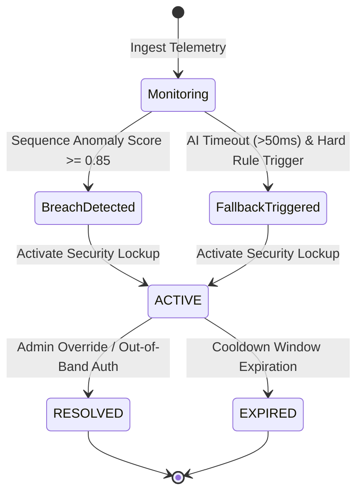

# Data Model: AI Password Anti-Breaching System

## Entities & Schemas

### 1. AuthenticationEntryDigest
Represents an anonymized, zero-knowledge telemetry record of a single login attempt.

| Field Name | Type | Description | Validation / Constraints |
|------------|------|-------------|--------------------------|
| `entry_id` | UUID / String | Unique identifier of the attempt telemetry | Non-empty UUID4 string |
| `timestamp` | Float / ISO String | Unix timestamp in seconds | Must be valid timestamp |
| `account_digest` | String | HMAC-SHA256 salted hash of target username/identifier | 64-character hex string |
| `ip_hash` | String | Obfuscated hash of source IP address | 64-character hex string |
| `char_length_bucket` | Integer | Anonymized password length category (e.g. 8, 12, 16+) | Positive integer |
| `device_signature_hash` | String | Obfuscated hash of User-Agent / device fingerprint | 64-character hex string |

### 2. SequenceTrajectoryWindow
Represents a temporal window of consecutive `AuthenticationEntryDigest` entries analyzed for ordered breach patterns.

| Field Name | Type | Description | Validation / Constraints |
|------------|------|-------------|--------------------------|
| `window_id` | UUID / String | Unique identifier of the sliding evaluation window | Non-empty UUID4 string |
| `start_time` | Float | Unix timestamp of oldest entry in window | `start_time <= end_time` |
| `end_time` | Float | Unix timestamp of newest entry in window | Current time scope |
| `entries` | List[AuthenticationEntryDigest] | Collection of entry digests in temporal order | Min 1, Max 500 entries |
| `ordered_pattern_score` | Float | Calculated anomaly confidence score (0.0 to 1.0) | `0.0 <= score <= 1.0` |
| `is_anomalous` | Boolean | Flag indicating breach pattern detection | True if score >= threshold |

### 3. SecurityLockupEvent
Represents an automated security lockdown action triggered by pattern detection or deterministic fallbacks.

| Field Name | Type | Description | Validation / Constraints |
|------------|------|-------------|--------------------------|
| `lockup_id` | UUID / String | Unique identifier of the lockdown incident | Non-empty UUID4 string |
| `triggered_at` | Float | Unix timestamp of lockup activation | Valid timestamp |
| `trigger_reason` | String | Pattern type (e.g. `ALPHABETICAL_SEQUENCE`, `DICTIONARY_TRAJECTORY`, `BURST_FALLBACK`) | Non-empty string |
| `confidence_score` | Float | Risk score associated with the trigger | `0.0 <= score <= 1.0` |
| `locked_account_digests` | List[String] | List of target account hashes locked | Non-empty list |
| `isolated_ip_hashes` | List[String] | List of source IP hashes isolated | Non-empty list |
| `status` | String | Current lockdown state (`ACTIVE`, `RESOLVED`, `EXPIRED`) | Enum: ACTIVE/RESOLVED/EXPIRED |

## State Transitions (Security Lockup)

